# Step 2-x / 2-y：营火上的参考 KL，以及按 HP 的门槛（`runs/step2x-refkl20`、`runs/step2y-refkl-hp`）

*Step 2-x：2026-10-09 11:06 ~ 12:38，193 局，中止。Step 2-y：2026-10-09 12:49 ~ 2026-10-10 14:10，3000 局（20 个周期），897 次更新。*

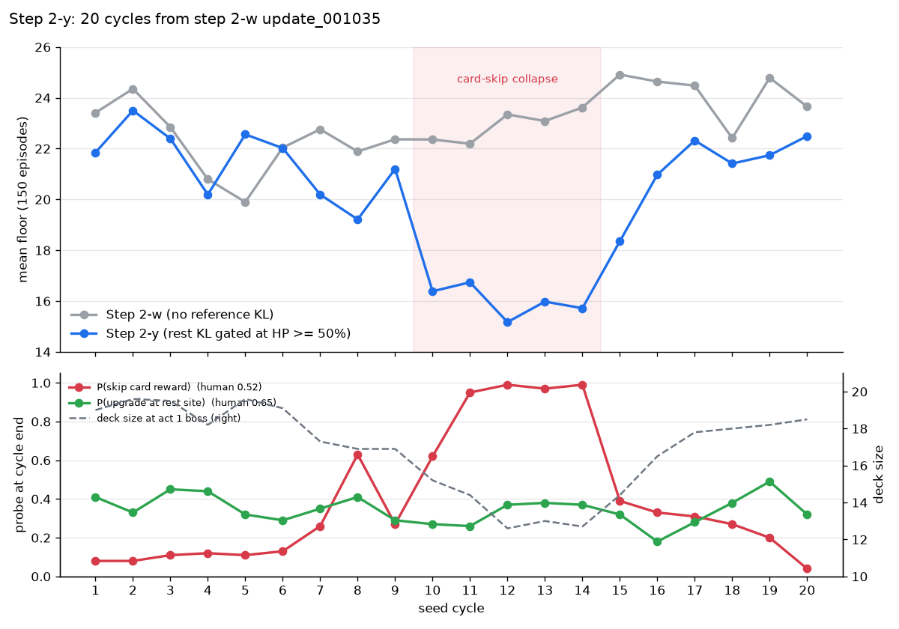

## 一句话

Step 2-w 的策略在营火上几乎从不升级（0.00–0.05，人类 0.65）。这一阶段从 Step 2-w 的最后一个 checkpoint 开始，在营火界面上加了一个向人类克隆策略靠拢的参考 KL（β 0.3）。

**Step 2-x（没有门槛）：**
- 升级的概率上去了；
- 但营火上的休息概率和 HP 无关，进入第 1 幕 boss 时的 HP 从 91% 降到 75%；
- 193 局后楼层比 Step 2-w 低 4.6 层，按 Lucien 的决定中止。

**Step 2-y：** 加了 HP 门槛（只在 HP ≥ 50% 的营火界面上加参考 KL），跑满 20 个周期。

- **门槛没有达到目的。** 营火上的休息概率在 HP < 50%、50–80%、> 80% 三个区间里始终相同（例如第 20 周期末 0.70 / 0.70 / 0.72，人类 0.62 / 0.19 / 0.06）。策略只是从"总是休息"变成"约 0.6–0.7 休息、0.3 升级"，不按 HP 区分。
- **选牌奖励反复漂移，第 10–14 周期整体崩溃。** 选牌奖励上没有参考 KL。"跳过卡牌"的概率从 0.08 一路升到 0.99（熵约 0），进入第 1 幕 boss 时的牌组从 19 张降到 12.6 张，平均楼层降到 15.2。第 15 周期起策略自己恢复，第 17–20 周期回到 21.4–22.5 层。
- **总体：** 全部 3000 局平均 20.02 层；和 Step 2-w 第 15–20 周期比同一批 seed，低 4.13 层（818 高 / 2101 低，p < 0.001）。
- **通关 2 局：** 第 2447 局 `4UEVB4R020`、第 2578 局 `YMQ4BC2NH5`。死在第 3 幕 boss 32 局。

## 背景

- Step 2-u（[step2tu-reference-kl.md](step2tu-reference-kl.md)）用按界面的参考 KL，把营火升级的概率从 0.01 拉到 0.27，楼层持平。
- Step 2-w（[step2w-plain20.md](step2w-plain20.md)）是普通 PPO：
  - 营火升级只在第 3–5 周期短暂出现（那时进入第 1 幕 boss 时 HP 55%，平均楼层跌到 19.9），之后回到 0；
  - 第 15–19 周期出现了第一批 4 局通关。
- Lucien 的要求（2026-10-09）：分析通关局的牌组，然后改参考 KL，从最新的 checkpoint 继续训练 20 个周期。

### 通关局的牌组和 boss（Step 2-w 的 4 局通关）

- 4 局通关的第 3 幕 boss 都是 Aeonglass：进入 Aeonglass 战 20 次，赢 4 次。Test Subject（27 次）和 Torch Head Amalgam + Queen（16 次）全败。
- 进入第 3 幕 boss 时，通关局平均带 1.75 瓶药水，失败局 0.69 瓶。其他状态（HP、牌组大小、升级牌、遗物）相近。

## Step 2-x：营火 β 0.3，没有门槛

### 训练方式

- `--init-from runs/step2w-plain10/checkpoints/update_001035.pt --init-optimizer`：Step 2-w 的最后一个 checkpoint，连同 Adam 的矩。
- 参考策略：`runs/bc-v7/bc_best.pt`（人类录像的克隆策略）。`--reference-kl 0 --reference-kl-screens rest_site=0.3,map=0.03`：只在营火（β 0.3）和地图（β 0.03）上加参考 KL，其他界面 β 为 0。
- 其余设置和 Step 2-w 相同：
  - MCTS 打全部战斗（普通和精英战 50 次模拟，boss 战 200 次）；
  - `--search-fights-out-of-rollout`，`--target-kl 0.02`；
  - 10 个模拟器，默认 seed 池（150 个），每 5 次更新一个 checkpoint。
- 驱动脚本：`runs/step2x_driver.sh`；代码 `feat/mcts-combat`（Step 2-w 末的提交）。

### 结果（193 局，按 Lucien 的决定中止）

| | Step 2-x | Step 2-w 末（w20） | 人类 |
|---|---|---|---|
| 平均楼层 | 19.52 | — | — |
| 对 Step 2-w 第 15–20 周期（同 seed） | −4.57（46 高 / 143 低，p < 0.001） | — | — |
| 营火 休息 / 升级 | 0.52 / 0.36 | 0.93 / 0.02 | 0.23 / 0.65 |
| 营火 休息，HP < 50% / 50–80% / > 80% | 0.54 / 0.51 / 0.51 | 0.92 / 0.95 / 0.90 | 0.62 / 0.19 / 0.06 |
| 营火 用药水 | 0.27 | 0.00 | 0.00 |
| 选牌 跳过 | 0.40 | 0.10 | 0.52 |
| 进入第 1 幕 boss 时 HP / 升级牌 | 75% / 2.0 | 91% / 0.63 | — |

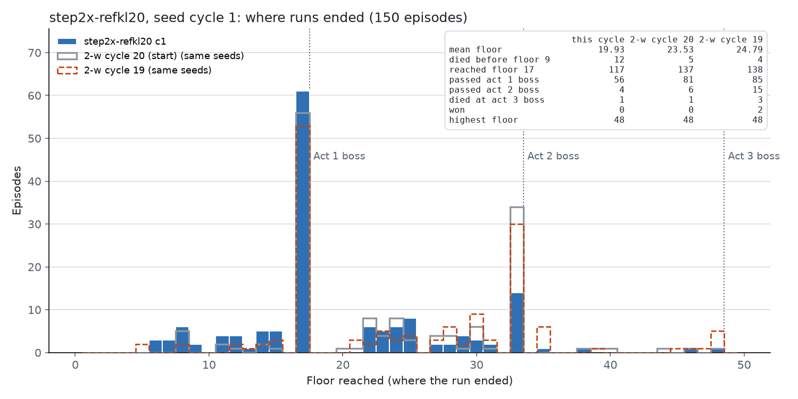

- 升级的概率上去了，但休息不按 HP 区分：参考策略（`bc-v7`）本身在营火上就不看 HP，β 0.3 把这一点也拉了过来。HP 低时少休息，第 1 幕 boss 的死亡率上升。
- 选牌奖励的 β 是 0，但"跳过"从 0.10 升到 0.40。Codex 认为最可能是共享编码器的耦合：营火和地图上的参考 KL 梯度经过共享的编码器，改变了选牌界面的输出。
- Lucien 的决定（选项 B）：中止 Step 2-x，加 HP 门槛后重新训练。

## HP 门槛的设计和实现

- **新参数：** `--reference-kl-min-hp screen=fraction`，例如 `rest_site=0.5`。在这个界面上，只有玩家 HP / 最大 HP ≥ fraction 时才加参考 KL。
- **实现**（`src/sts2rl/agents/ppo.py`；由子代理实现，Codex 审查了设计和改动；提交 `a1b8042`，合并为 `3b07059`）：
  - `PPOConfig.reference_kl_min_hp`：(界面, 比例) 的元组。比例必须在 (0, 1] 之内；在 β 不为正的界面上设门槛会被拒绝。
  - 门槛在采样时判断：`choose_action` 里用 `ratio_feature(hp, max_hp)` 算 HP 比例。缺少 HP 或 HP 无效时，按"低于门槛"处理。
  - 被门槛挡住的步骤在 `_PendingDecision` / `_RolloutStep` 上带 `reference_gated` 标记。更新时这些步骤不加参考 KL 项，但仍然计入分母（所以门槛降低的是参考 KL 的总剂量，而不是把剩下步骤的权重放大）。
  - 新指标 `reference_gated/<screen>`：每次更新里被门槛挡住的步数。
  - `--resume` 时不允许改门槛；`without_reference()` 会同时清掉门槛。
- **测试：** 新增 `test_ppo_agent.py`、`test_training_cli.py`、`test_training_config.py` 的用例，全部 989 个测试通过，ruff 无报错。
- **Codex 审查的要点：**
  - 门槛符合设计的按状态的损失。
  - 第一个周期要测：门槛是否正确（HP < 0.5 时没有参考项）；参考 KL 的剂量；固定的人类界面上按 HP 的休息 / 升级概率；早死、到达第 1 幕 boss 的比例；进入 boss 时的 HP 分布。
  - **"实现正确，但低 HP 时的休息仍然下降"是可能的结果。** 门槛只决定参考项在哪里生效，不保证策略学会按 HP 区分。

## Step 2-y：营火 β 0.3，只在 HP ≥ 50% 时生效

### 训练方式

```bash
uv run sts2rl-train --run-dir runs/step2y-refkl-hp --backend sim --base-url http://localhost:15600/api/v1 \
  --ports 15600,15601,15602,15603,15604,15605,15606,15607,15608,15609 --seed-pool default --holdout-seeds default \
  --init-from runs/step2w-plain10/checkpoints/update_001035.pt --init-optimizer \
  --reference-policy runs/bc-v7/bc_best.pt --reference-kl 0 --reference-kl-screens rest_site=0.3,map=0.03 \
  --reference-kl-min-hp rest_site=0.5 \
  --search-combat --search-fights-out-of-rollout --search-boss-simulations 200 --target-kl 0.02 \
  --checkpoint-every 5 --total-episodes 3000
```

- 和 Step 2-x 唯一的不同是 `--reference-kl-min-hp rest_site=0.5`。代码 `3b07059`。
- PPO：学习率 3e-4，rollout 256，minibatch 32，4 个 epoch，clip 0.2，`target_kl` 0.02（超过 0.03 停止这次更新），γ 0.999，λ 0.98，熵系数 0.01，价值系数 0.5，梯度裁剪 0.5。
- 奖励：每进入一个节点 +1，每打赢一个 boss +10，每步 −0.01。
- 一次启动跑完，没有中断。约 120 局/小时，截断 0，action error 0。
- 后台脚本：
  - 驱动 `runs/step2y_driver.sh`；
  - 每个周期末记录 checkpoint 并探测 `runs/step2y_cycle_record.sh`（结果在 `runs/probe/step2y_c<N>.txt`）；
  - 通关自动保存 `runs/step2y_win_saver.sh`。
- 每个周期末的 checkpoint，以及漂移前后的几个 checkpoint，复制到了 `runs/step2y-keep/`（训练会清理旧的 checkpoint）。
- 训练中不做 holdout 评估。

### 每个周期（训练中，按概率采样）

| 周期 | checkpoint | 平均楼层 | 最高 | 到第 17 层 | 过第 1 幕 boss | 过第 2 幕 boss | 第 3 幕 boss 死亡 | 通关 | 第 9 层前死亡 | 对上一周期（同 seed） | 对 Step 2-w 第 15–20 周期平均（同 seed） |
|---|---|---|---|---|---|---|---|---|---|---|---|
| 1 | `update_000048` | 21.85 | 48 | 130 | 76 / 130（58%） | 6 | 1 | 0 | 7 | — | −2.13（54 高 / 87 低，p = 0.0068） |
| 2 | `update_000102` | 23.50 | 48 | 134 | 80 / 134（60%） | 7 | 2 | 0 | 3 | +1.27（p = 0.43） | −0.45（p = 0.8） |
| 3 | `update_000150` | 22.39 | 46 | 129 | 71 / 129（55%） | 10 | 0 | 0 | 4 | −1.27（p = 0.076） | −1.61（p = 0.065） |
| 4 | `update_000198` | 20.19 | 48 | 113 | 54 / 113（48%） | 4 | 1 | 0 | 10 | −2.49（41 高 / 72 低，p = 0.0046） | −3.88（p < 0.001） |
| 5 | `update_000252` | 22.56 | 48 | 132 | 73 / 132（55%） | 7 | 1 | 0 | 7 | +2.52（70 高 / 43 低，p = 0.014） | −1.40（p = 0.065） |
| 6 | `update_000300` | 22.02 | 48 | 134 | 69 / 134（51%） | 10 | 2 | 0 | 3 | −0.62（p = 0.27） | −2.14（p < 0.001） |
| 7 | `update_000342` | 20.19 | 48 | 120 | 57 / 120（48%） | 5 | 2 | 0 | 8 | −2.02（40 高 / 67 低，p = 0.012） | −3.94（p < 0.001） |
| 8 | `update_000384` | 19.21 | 50 | 114 | 45 / 114（39%） | 7 | 1 | 0 | 10 | −0.96（p = 0.22） | −4.87（p < 0.001） |
| 9 | `update_000432` | 21.20 | 48 | 125 | 63 / 125（50%） | 3 | 2 | 0 | 7 | +1.86（p = 0.073） | −2.76（p < 0.001） |
| 10 | `update_000469` | **16.39** | 48 | 85 | 25 / 85（29%） | 5 | 2 | 0 | **29** | −5.27（30 高 / 84 低，p < 0.001） | −7.60（p < 0.001） |
| 11 | `update_000505` | 16.74 | 48 | 95 | 22 / 95（23%） | 3 | 1 | 0 | 16 | +0.36（p = 0.77） | −7.46（p < 0.001） |
| 12 | `update_000541` | **15.17** | 33 | 88 | 11 / 88（12%） | 0 | 0 | 0 | 18 | −1.63（34 高 / 57 低，p = 0.021） | −8.88（p < 0.001） |
| 13 | `update_000571` | 15.98 | 33 | 96 | 13 / 96（14%） | 0 | 0 | 0 | 14 | +0.92（p = 0.17） | −8.05（p < 0.001） |
| 14 | `update_000607` | 15.72 | 33 | 95 | 16 / 95（17%） | 0 | 0 | 0 | 17 | −0.51（p = 0.19） | −8.49（p < 0.001） |
| 15 | `update_000649` | 18.35 | 48 | 116 | 38 / 116（33%） | 3 | 1 | 0 | 14 | +2.61（62 高 / 32 低，p = 0.0026） | −5.76（p < 0.001） |
| 16 | `update_000697` | 20.97 | 50 | 125 | 59 / 125（47%） | 6 | 3 | 0 | 7 | +2.66（p = 0.17） | −3.12（p < 0.001） |
| 17 | `update_000745` | 22.32 | 48 | 130 | 71 / 130（55%） | 10 | 3 | **1** | 4 | +0.97（p = 0.78） | −2.01（p = 0.0068） |
| 18 | `update_000793` | 21.41 | 48 | 123 | 65 / 123（53%） | 7 | 1 | **1** | 8 | −0.33（p = 0.76） | −2.39（p < 0.001） |
| 19 | `update_000847` | 21.74 | 48 | 126 | 71 / 126（56%） | 8 | 6 | 0 | 9 | +0.11（p = 1） | −2.10（p < 0.001） |
| 20 | `update_000897` | 22.49 | 50 | 135 | 74 / 135（55%） | 5 | 3 | 0 | 7 | +0.71（p = 0.39） | −1.69（60 高 / 85 低，p = 0.046） |

- **全部 3000 局：** 平均 20.02，最高 50；到第 3 幕 boss 34 局（通关 2，死亡 32）；和 Step 2-w 第 15–20 周期比同一批 seed −4.13（818 高 / 2101 低，p < 0.001）。
- p 是符号检验。周期按局号切分（第 c 周期 = 第 150(c−1)+1 到 150c 局）。"对 Step 2-w 第 15–20 周期平均"把每个 seed 和它在 Step 2-w 第 15–20 周期里的平均楼层比较。
- **没有一个周期达到 Step 2-w 第 15–20 周期的水平。** 最好的第 2 周期是 −0.45（不显著）；第 17–20 周期恢复后仍然低 1.7–2.4 层。

### 通关和第 3 幕 boss

**通关 2 局**（详见 [wins.md](wins.md)；checkpoint 和这一局的战斗记录保存在本机 `runs/wins/`）：

| 局 | 周期 | seed | 三个 boss | 进入 boss 战时 HP |
|---|---|---|---|---|
| 2447 | 17 | `4UEVB4R020` | Ceremonial Beast → Knowledge Demon → Aeonglass | 80/80 → 80/80 → 80/80 |
| 2578 | 18 | `YMQ4BC2NH5` | Kin Follower ×2 + Kin Priest → The Insatiable → Torch Head Amalgam + Queen | 65/80 → 80/80 → 100/100 |

- `4UEVB4R020` 在 Step 2-w 第 2746 局也通关过，boss 完全相同；本 run 里它在第 953、2298 局死在第 3 幕 boss。
- `YMQ4BC2NH5` 是第一个第 3 幕 boss 不是 Aeonglass 的通关：Torch Head Amalgam + Queen 在 Step 2-w 里 16 次全败。
- **死在第 3 幕 boss 32 局**，多次出现的 seed：`CQ3PNLJZ4G`、`CNL0342G9S`、`H14T0C5F9B`（各 3 次）；`NYBVL26E3R`、`4UEVB4R020`、`V1WJ9EMZ3B`（各 2 次）。第 19 周期最多（6 局），但没有通关。
- 第 12–14 周期没有一局过第 2 幕 boss，最高第 33 层。

### floor 分布

每张图对比上一个周期（同 seed）和 Step 2-w 第 20 周期（起点，同 seed）。

| | |
|---|---|
| 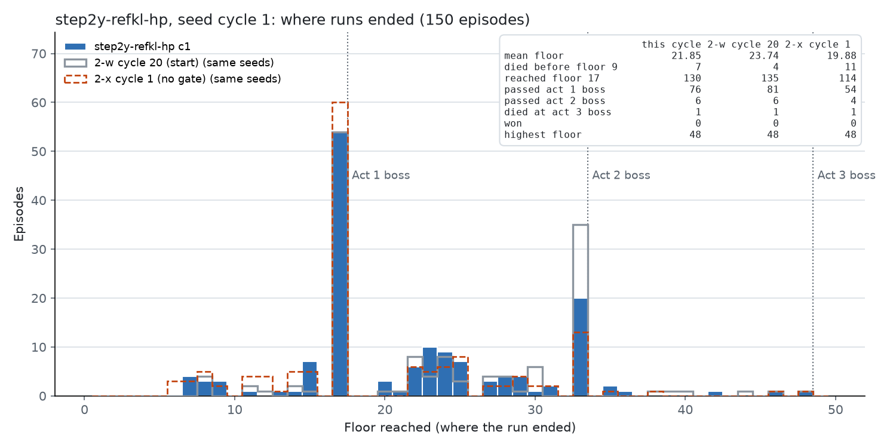 | 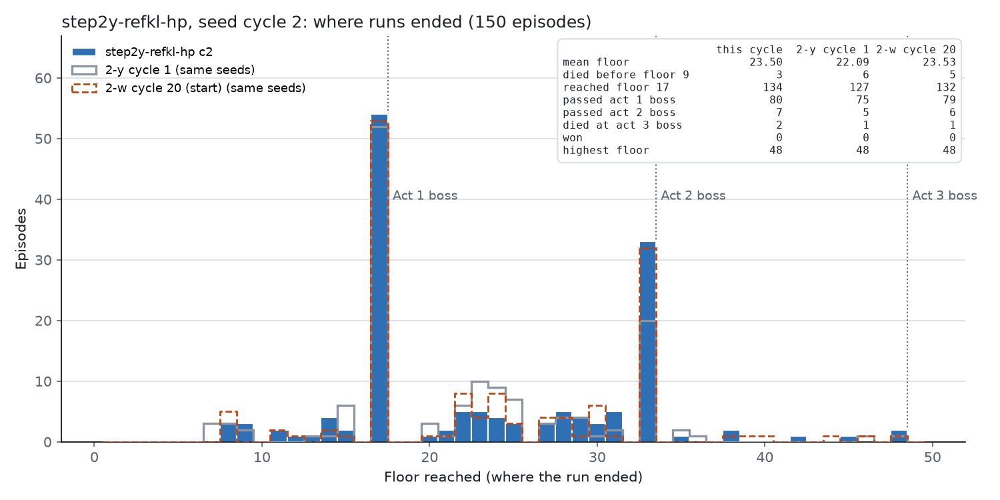 |
| 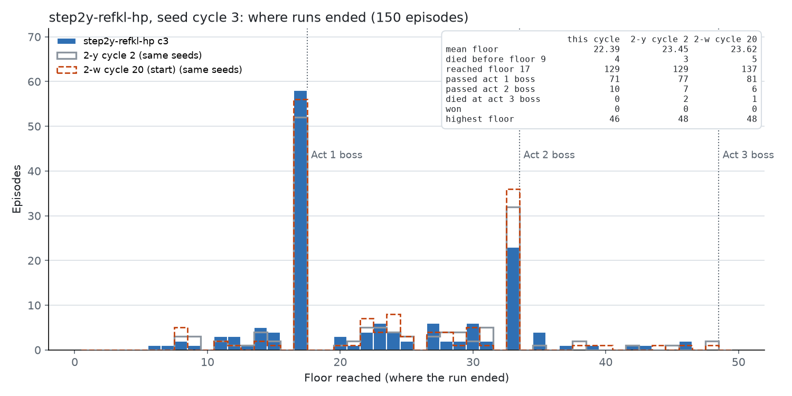 | 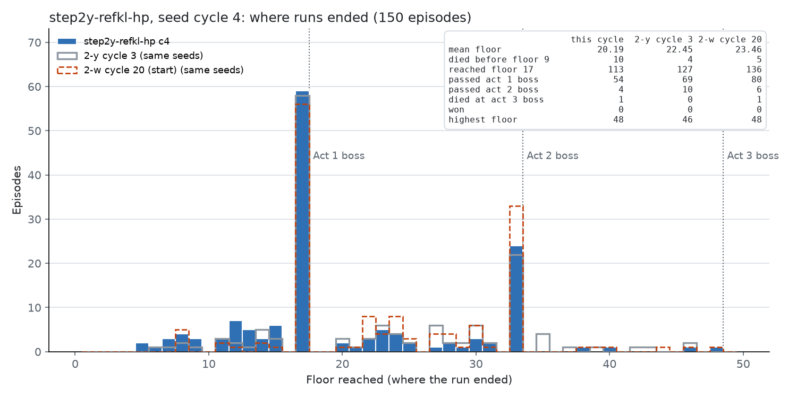 |
| 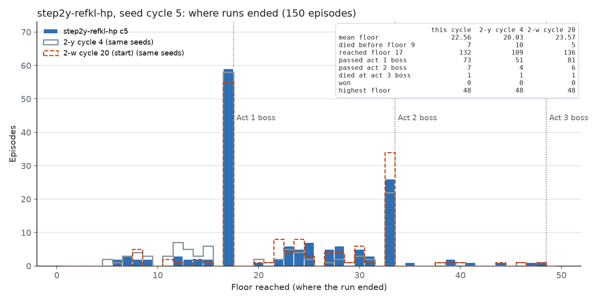 | 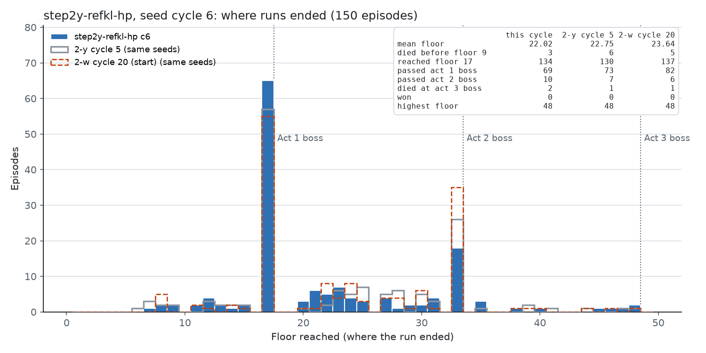 |
| 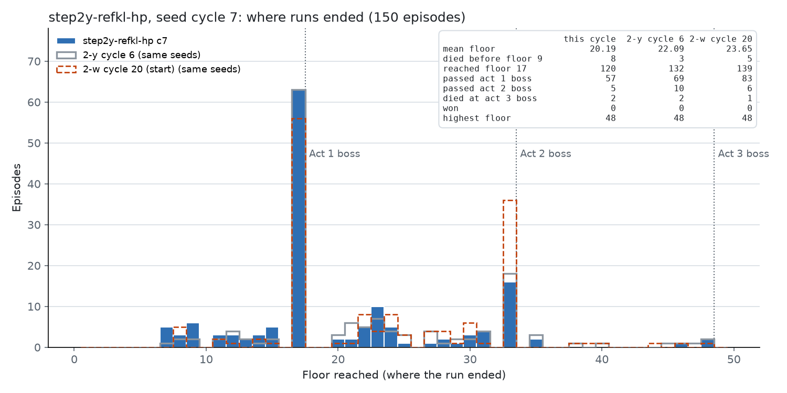 | 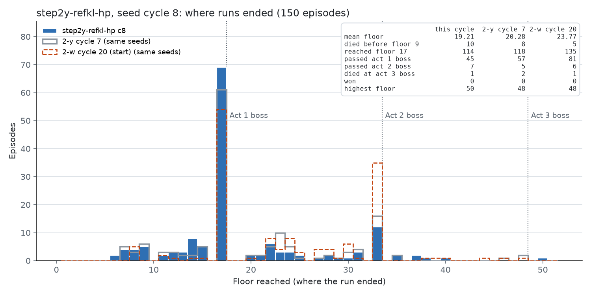 |
| 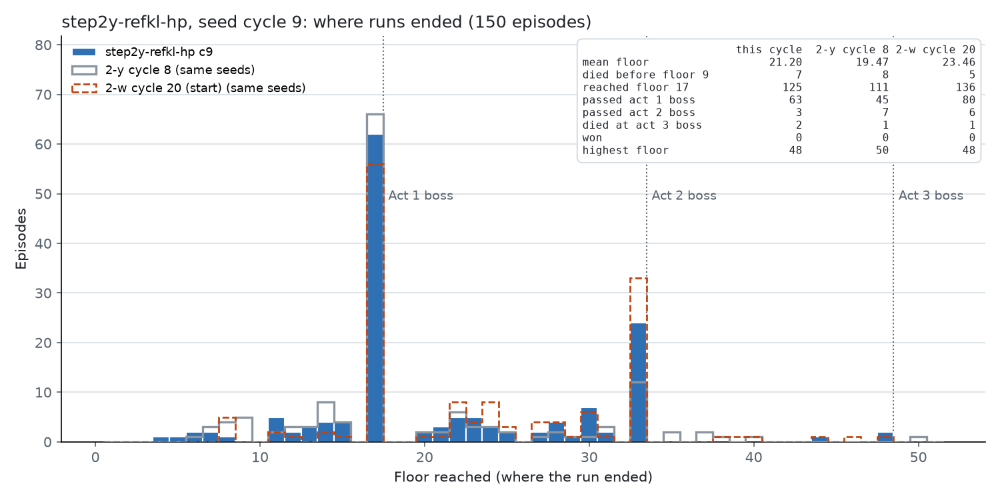 | 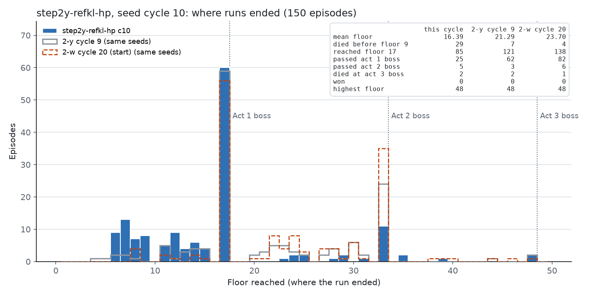 |
| 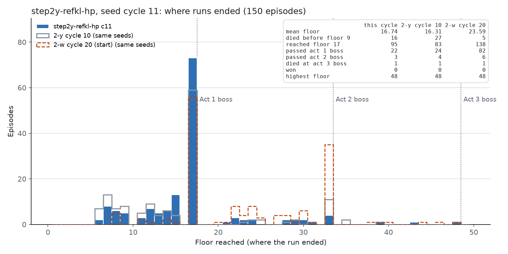 | 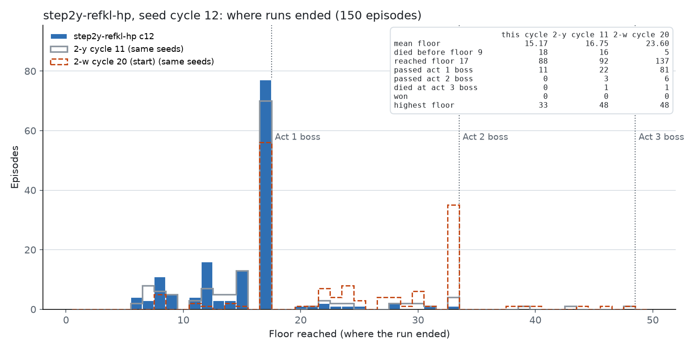 |
| 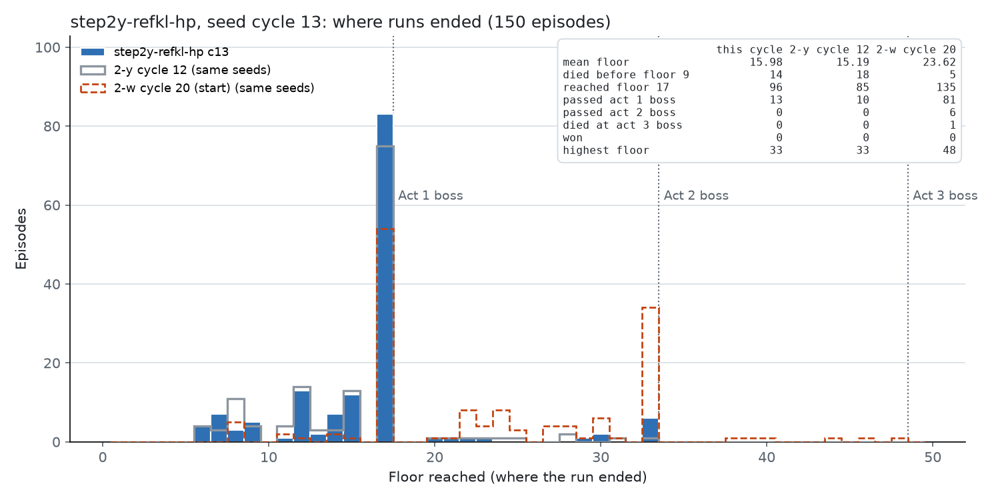 | 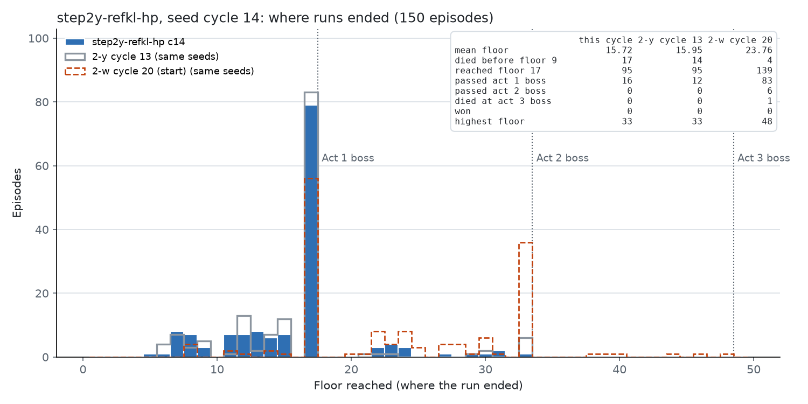 |
| 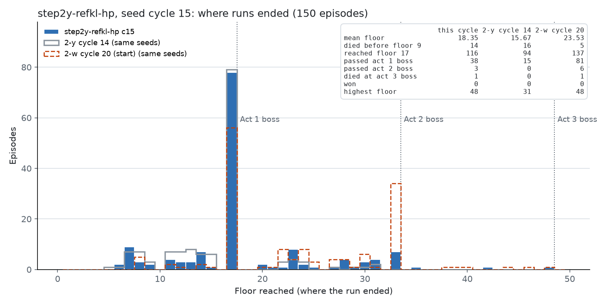 | 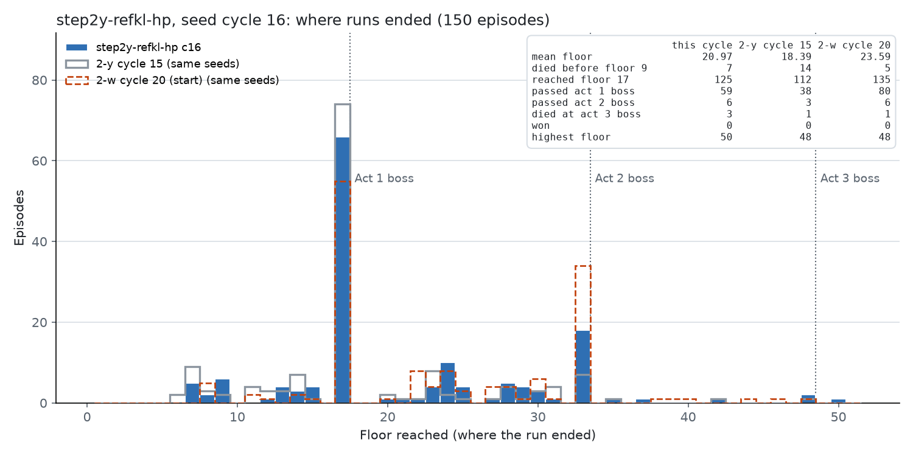 |
| 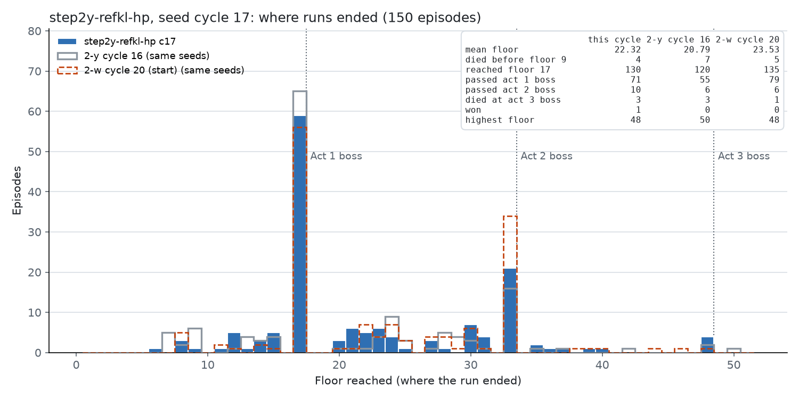 | 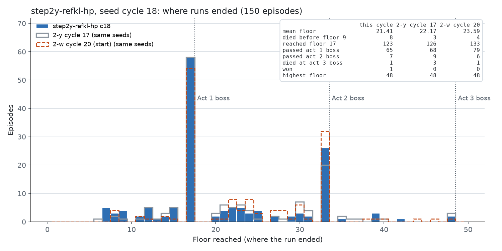 |
| 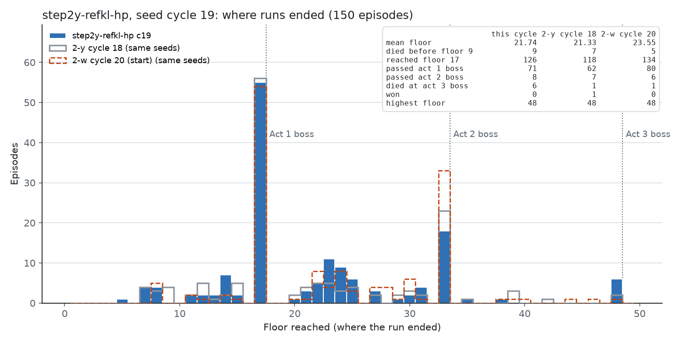 | 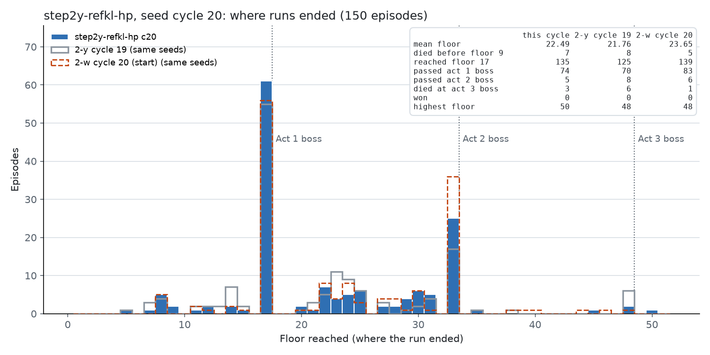 |

### 探测（人类录像的 1317 个宏观界面，每个周期末的 checkpoint）

每个数是"在提供这个选项的界面上，策略选它的概率"的平均，所以商店的几项加起来不等于 1。w20 是起点（Step 2-w 的 `update_001035`）。

| 选项 | 人类 | w20 | c1 | c2 | c3 | c4 | c5 | c6 | c7 | c8 | c9 | c10 | c11 | c12 | c13 | c14 | c15 | c16 | c17 | c18 | c19 | c20 |
|---|---|---|---|---|---|---|---|---|---|---|---|---|---|---|---|---|---|---|---|---|---|---|
| 营火 休息 | 0.23 | 0.93 | 0.49 | 0.65 | 0.44 | 0.51 | 0.71 | 0.73 | 0.64 | 0.58 | 0.72 | 0.70 | 0.70 | 0.60 | 0.61 | 0.60 | 0.67 | 0.83 | 0.74 | 0.65 | 0.55 | 0.71 |
| 营火 升级 | 0.65 | 0.02 | 0.41 | 0.33 | 0.45 | 0.44 | 0.32 | 0.29 | 0.35 | 0.41 | 0.29 | 0.27 | 0.26 | 0.37 | 0.38 | 0.37 | 0.32 | 0.18 | 0.28 | 0.38 | 0.49 | 0.32 |
| 营火 休息，HP < 50% | 0.62 | 0.92 | 0.49 | 0.64 | 0.44 | 0.49 | 0.70 | 0.73 | 0.64 | 0.58 | 0.71 | 0.69 | 0.69 | 0.58 | 0.58 | 0.60 | 0.67 | 0.84 | 0.74 | 0.65 | 0.53 | 0.70 |
| 营火 休息，HP 50–80% | 0.19 | 0.95 | 0.49 | 0.66 | 0.44 | 0.51 | 0.71 | 0.73 | 0.65 | 0.59 | 0.72 | 0.71 | 0.72 | 0.61 | 0.62 | 0.62 | 0.68 | 0.82 | 0.74 | 0.64 | 0.54 | 0.70 |
| 营火 休息，HP > 80% | 0.06 | 0.90 | 0.49 | 0.63 | 0.43 | 0.52 | 0.72 | 0.74 | 0.64 | 0.58 | 0.72 | 0.68 | 0.68 | 0.59 | 0.62 | 0.57 | 0.67 | 0.82 | 0.75 | 0.66 | 0.56 | 0.72 |
| 营火 用药水 | 0.00 | 0.00 | 0.18 | 0.01 | 0.42 | 0.34 | 0.02 | 0.01 | 0.01 | 0.01 | 0.00 | 0.00 | 0.00 | 0.00 | 0.01 | 0.00 | 0.01 | 0.02 | 0.00 | 0.01 | 0.01 | 0.01 |
| 选牌 跳过 | 0.52 | 0.10 | 0.08 | 0.08 | 0.11 | 0.12 | 0.11 | 0.13 | 0.26 | **0.63** | 0.27 | **0.62** | **0.95** | **0.99** | **0.97** | **0.99** | 0.39 | 0.33 | 0.31 | 0.27 | 0.20 | 0.04 |
| 商店 买牌 | 0.22 | 0.33 | 0.28 | 0.73 | 0.64 | 0.73 | 0.64 | 0.45 | 0.36 | 0.50 | 0.41 | 0.40 | 0.27 | 0.34 | 0.59 | 0.30 | 0.26 | 0.41 | 0.46 | 0.45 | 0.18 | 0.31 |
| 商店 移除卡 | 0.24 | 0.02 | 0.02 | 0.13 | 0.08 | 0.10 | 0.09 | 0.06 | 0.06 | 0.12 | 0.08 | 0.06 | 0.03 | 0.04 | 0.11 | 0.15 | 0.25 | 0.02 | 0.04 | 0.06 | 0.48 | 0.28 |
| 商店 买遗物 | 0.18 | 0.61 | 0.73 | 0.07 | 0.31 | 0.17 | 0.30 | 0.56 | 0.71 | 0.46 | 0.64 | 0.67 | 0.89 | 0.83 | 0.33 | 0.73 | 0.60 | 0.89 | 0.70 | 0.67 | 0.68 | 0.47 |
| 商店 买药水 | 0.04 | 0.70 | 0.67 | 0.35 | 0.32 | 0.26 | 0.31 | 0.44 | 0.46 | 0.36 | 0.42 | 0.42 | 0.41 | 0.20 | 0.34 | 0.37 | 0.57 | 0.13 | 0.26 | 0.29 | 0.34 | 0.59 |
| 地图 精英 | 0.08 | 0.00 | 0.01 | 0.04 | 0.08 | 0.01 | 0.02 | 0.06 | 0.02 | 0.06 | 0.15 | 0.15 | 0.03 | 0.06 | 0.05 | 0.05 | 0.18 | 0.05 | 0.04 | 0.03 | 0.02 | 0.03 |
| 地图 营火 | 0.20 | 0.99 | 0.97 | 0.95 | 0.85 | 0.98 | 0.89 | 0.80 | 0.85 | 0.85 | 0.67 | 0.69 | 0.88 | 0.81 | 0.86 | 0.88 | 0.76 | 0.93 | 0.84 | 0.86 | 0.86 | 0.76 |

- **营火：** 升级的概率从 0.02 升到 0.18–0.49，休息降到 0.44–0.83。但在每一个周期末，三个 HP 区间的休息概率相差都不超过 0.03。
- **营火用药水**在第 1、3、4 周期末出现过（0.18–0.42，人类 0），之后回到约 0。营火上唯一能用的是 Blood Potion。
- **选牌跳过**在第 7 周期开始上升，第 11–14 周期末是 0.95–0.99，第 15 周期回落，第 20 周期末是 0.04。周期中间的 checkpoint 探测到的漂移更多（见下文）。
- **商店**一直在摆：买遗物 0.07–0.89，买牌 0.18–0.73。第 19 周期末移除卡 0.48（人类 0.24，起点 0.02），这是整个项目里第一次出现明显的移除卡。

### 进入第 1 幕 boss 时的状态（平均）

| 周期 | 进入局数 | HP | 牌组 | 升级牌 | 药水 | 遗物 | 金币 | 第 1 幕 boss 死亡率 |
|---|---|---|---|---|---|---|---|---|
| 1 | 132 | 84% | 19.0 | 1.45 | 0.90 | 4.44 | 140 | 40% |
| 2 | 132 | 82% | 19.6 | 1.73 | 0.72 | 4.34 | 117 | 41% |
| 3 | 131 | 75% | 19.5 | 2.32 | 0.73 | 4.20 | 118 | 45% |
| 4 | 111 | 74% | 18.2 | 2.06 | 0.80 | 4.43 | 118 | 51% |
| 5 | 133 | 76% | 19.6 | 1.92 | 0.78 | 4.23 | 123 | 44% |
| 6 | 134 | 77% | 19.1 | 1.69 | 0.69 | 4.42 | 129 | 49% |
| 7 | 119 | 77% | 17.3 | 1.80 | 0.81 | 4.34 | 110 | 53% |
| 8 | 117 | 76% | 16.9 | 1.58 | 0.75 | 4.44 | 115 | 61% |
| 9 | 125 | 82% | 16.9 | 1.55 | 0.89 | 4.35 | 122 | 49% |
| 10 | 85 | 71% | 15.2 | 1.38 | 0.71 | 4.29 | 135 | 72% |
| 11 | 94 | 75% | 14.4 | 1.34 | 0.73 | 4.36 | 129 | 76% |
| 12 | 91 | 74% | **12.6** | 1.20 | 0.59 | 4.35 | 148 | **88%** |
| 13 | 95 | 70% | 13.0 | 1.41 | 0.74 | 4.34 | 113 | 86% |
| 14 | 96 | 70% | 12.7 | 1.50 | 0.71 | 4.26 | 120 | 82% |
| 15 | 112 | 80% | 14.4 | 1.13 | 0.67 | 4.05 | 124 | 67% |
| 16 | 126 | 81% | 16.5 | 1.46 | 0.88 | 3.98 | 126 | 52% |
| 17 | 130 | 85% | 17.8 | 1.18 | 0.71 | 4.34 | 113 | 46% |
| 18 | 127 | 80% | 18.0 | 1.54 | 0.80 | 4.25 | 114 | 46% |
| 19 | 125 | 81% | 18.2 | 1.42 | 0.72 | 4.30 | 117 | 41% |
| 20 | 142 | 79% | 18.5 | 1.42 | 0.85 | 3.97 | 108 | 48% |
| Step 2-w 第 15–20 周期 | 805 | 91% | 19.1–19.9 | 0.63 | 0.62–0.91 | 4.0–4.4 | 104–147 | 33–49% |

这张表按搜索记录的 run id 第一次出现的顺序分周期（战斗记录没有 seed），周期边界可能差几局。

- **HP 和升级的交换：** 升级牌从 0.63 张升到 1.1–2.3 张，进入时 HP 从 91% 降到 70–85%。第 1–9 周期（选牌还正常时），第 1 幕 boss 死亡率 40–61%，高于 Step 2-w 第 15–20 周期的 33–49%。和 Step 2-w 第 4–5 周期（升级 3.7 张、HP 55%）一样，升级换来的不够补偿少休息的代价。
- **选牌崩溃时：** 牌组降到 12.6–13.0 张（初始牌组约 10 张），第 1 幕 boss 死亡率 82–88%，第 9 层前死亡的局多了 2–4 倍。

### 训练指标

| 周期 | 更新 | 停止时 KL 中位 | KL > 0.3 的次数 | 熵 | 价值损失（均 / 最高） | 营火参考 KL（均） | 地图参考 KL（均） | 门槛挡住的营火步（每次更新，均） | 回报缩放 |
|---|---|---|---|---|---|---|---|---|---|
| 1 | 52 | 0.057 | 4 | 0.63 | 0.05 / 0.43 | 0.420 | 0.551 | 2.9 | 15.70 |
| 2 | 52 | 0.055 | 4 | 0.74 | 0.05 / 0.16 | 0.332 | 0.516 | 2.7 | 15.74 |
| 3 | 50 | 0.073 | 8 | 0.83 | 0.05 / 0.12 | 0.155 | 0.311 | 3.4 | 15.73 |
| 4 | 45 | 0.051 | 4 | 0.87 | 0.07 / 0.19 | 0.093 | 0.228 | 3.2 | 15.74 |
| 5 | 53 | 0.075 | 6 | 0.84 | 0.05 / 0.19 | 0.201 | 0.358 | 2.9 | 15.76 |
| 6 | 49 | 0.046 | 1 | 0.86 | 0.04 / 0.18 | 0.210 | 0.261 | 3.1 | 15.77 |
| 7 | 45 | 0.046 | 0 | 0.80 | 0.05 / 0.22 | 0.256 | 0.341 | 3.3 | 15.77 |
| 8 | 43 | 0.052 | 0 | 0.75 | 0.04 / 0.21 | 0.192 | 0.378 | 2.9 | 15.76 |
| 9 | 48 | 0.072 | 5 | 0.72 | 0.05 / 0.22 | 0.270 | 0.609 | 2.9 | 15.77 |
| 10 | 36 | **0.258** | **16** | 0.70 | 0.05 / 0.23 | 0.268 | **1.870** | 3.4 | 15.74 |
| 11 | 36 | 0.053 | 5 | 0.65 | 0.04 / 0.15 | 0.391 | 0.441 | 3.3 | 15.74 |
| 12 | 31 | 0.047 | 1 | 0.54 | 0.02 / 0.06 | 0.333 | 0.398 | 3.7 | 15.70 |
| 13 | 35 | 0.050 | 1 | 0.65 | 0.02 / 0.06 | 0.217 | 0.522 | 3.4 | 15.65 |
| 14 | 35 | 0.055 | 1 | 0.55 | 0.02 / 0.06 | 0.226 | 0.291 | 3.2 | 15.60 |
| 15 | 40 | 0.084 | 7 | 0.50 | 0.03 / 0.09 | 0.471 | 0.524 | 3.0 | 15.57 |
| 16 | 47 | 0.074 | 7 | 0.55 | 0.04 / 0.15 | 0.364 | 0.444 | 2.8 | 15.57 |
| 17 | 51 | 0.055 | 8 | 0.60 | 0.05 / 0.18 | 0.333 | 0.425 | 2.8 | 15.61 |
| 18 | 49 | 0.044 | 1 | 0.70 | 0.05 / 0.16 | 0.246 | 0.313 | 2.4 | 15.62 |
| 19 | 51 | 0.053 | 7 | 0.68 | 0.05 / 0.26 | 0.297 | 0.404 | 2.6 | 15.64 |
| 20 | 49 | 0.082 | 6 | 0.80 | 0.05 / 0.21 | 0.275 | 0.389 | 2.8 | 15.69 |

- 更新按文件里出现的顺序，归到它之前最后完成的那一局所在的周期。第 10–14 周期局更短，每个周期的更新次数更少。
- **门槛每次更新只挡住约 3 个营火步骤**（256 步的 rollout 里营火步骤本来就少）。
- **第 10 周期的地图参考 KL 平均 1.87：** 第 440 次更新时是 8.98，那次更新停止时的 KL 是 0.56。这是整个 run 里地图策略最大的一次跳动。
- 价值损失一直很低（0.02–0.07）。崩溃期间降到 0.02：critic 准确地预测了"跳过卡牌"策略的低回报。critic 没有出错，PPO 也没有收到离开这个状态的信号。

## 选牌奖励的漂移

周期末的探测只看到一部分，周期中间的 checkpoint 显示漂移发生了 5 次以上：

| 次 | checkpoint | 选牌跳过（漂移前 → 最高 → 恢复后） | 同时发生的变化 | 楼层 |
|---|---|---|---|---|
| 1 | u150 → u162 → u186 | 0.11 → 0.84 → 0.11 | 商店丢药水 0.02 → 0.66；假商人丢药水 0.95 | 第 4 周期 20.19 |
| 2 | u252 → u282 → u288 | 0.11 → 0.62 → 0.19 | 商店买遗物 0.30 → 0.71 | 第 6 周期 22.02（影响小） |
| 3 | u300 → u324 → u336 | 0.13 → 0.96 → 0.28 | — | 第 7 周期 20.19 |
| 4 | u360 → u372 → u408 | 0.25 → 0.96 → 0.34 | — | 第 8 周期 19.21 |
| 5 | u432 → u444 → u631 | 0.27 → 0.96 → 0.40 | 地图和 c9 的 KL 1.6–2.2，地图熵 0.71 → 0.20；第 440 次更新地图参考 KL 8.98 | 第 10–14 周期 15.2–16.7 |

- **前 4 次都在 15–30 次更新内自己恢复。第 5 次持续了约 190 次更新**（第 10–14 周期）。期间选牌界面的熵降到 0.01–0.13，策略几乎不再采到"拿卡"，所以也学不到拿卡更好。
- **恢复的方式不是回到原来的分布：** u631 的平均拿卡概率 0.60，但熵只有 0.13。也就是说，在约 60% 的界面上一定拿卡，在其他界面上一定跳过。
- **可能的先兆：** 在第 1、2 次漂移之前，以及第 5 次漂移在第 11 周期再次加重之前，critic 对人类选牌界面的估值都先升到约 0.9–1.0（例如 u150 → u162 → u168 是 0.32 → 0.67 → 1.02）。但第 17 周期末也升到过 1.04，之后没有漂移，所以它不是可靠的预警。
- **Step 2-w（同一个起点，没有参考 KL）的 20 个周期里，选牌跳过一直 ≤ 0.10。** 漂移只在营火和地图上有参考 KL 时出现（Step 2-x 第 1 周期就到了 0.40）。Codex 的解释是共享编码器的耦合：参考 KL 只作用在营火和地图的输出上，但它的梯度经过共享的编码器，也改变了选牌界面的表示，而选牌界面上没有任何项把它拉回来。这还是假设，还没有用实验区分。

## 结论

1. **HP 门槛没有让策略按 HP 选择。** 门槛只决定参考 KL 在哪些营火界面上生效；参考策略（`bc-v7`）本身在营火上不看 HP，PPO 的回报也没有把 HP 和休息的价值联系起来。结果是策略在所有 HP 下都用同一个"休息约 0.6–0.7、升级约 0.3"的混合。这正是 Codex 审查时说的"实现正确，但目的没有达到"的情况。策略在营火上到底能不能看到 HP，还没有直接检查过。
2. **只在部分界面加参考 KL 会引起其他界面漂移。** 没有参考 KL 的选牌奖励和商店反复漂移，其中一次让整个 run 崩溃了 5 个周期。Step 2-w 没有这个问题。
3. **升级换不来楼层。** 升级牌多了 1–1.7 张，但 HP 低了 6–20 个百分点，第 1 幕 boss 死亡率反而更高。这和 Step 2-u、Step 2-w 第 4–5 周期的结论一致。
4. 第 17–20 周期恢复后（21.4–22.5 层），仍然比起点低约 2 层。在 Step 2-w 的 checkpoint 上加营火参考 KL，没有找到改进。

## 下一步（待 Lucien 决定）

- **给所有宏观界面加参考 KL**（选牌奖励、商店、事件也加，例如 β 0.03），从漂移前的 checkpoint（例如 c6 `runs/step2y-keep/update_000300.pt`）或 Step 2-w 的 `update_001035` 开始。目的是检验"没有参考 KL 的界面会漂移"这个解释。
- **离线检查营火上的 HP：** 只改人类营火界面上的 HP，看策略和 critic 的输出会不会变。如果不变，问题在特征或编码器，再怎么训练营火也学不会按 HP 选择。只用 CPU，约 10 分钟。
- **漂移的早期发现：** 如果继续这类训练，在训练中每隔几次更新探测一次选牌跳过的概率（几十秒），比等周期末更早发现漂移。
