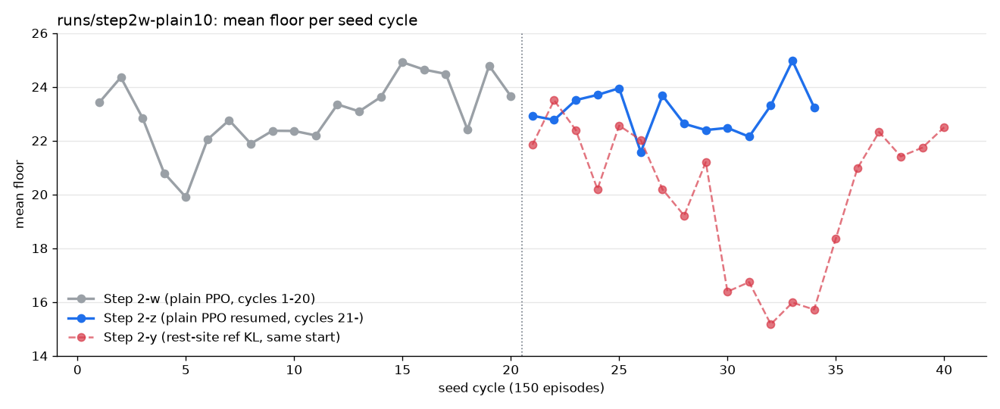
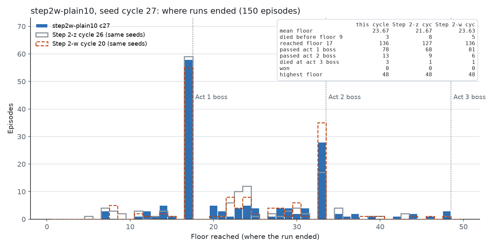
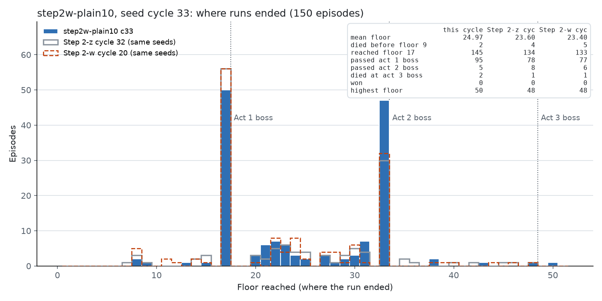

# Step 2-z：从 Step 2-w 末尾继续普通 PPO（`runs/step2w-plain10` 第 21–35 周期）

*2026-10-10 16:38 ~ 2026-10-11 15:25，2129 局（第 3001–5129 局），更新 1035 → 1773，一次启动，按 Lucien 的指令在第 35 周期第 29 局时停止*



## 一句话

Step 2-y（营火参考 KL）比 Step 2-w 低 4.1 层，所以 Lucien 决定不再加参考 KL，从 Step 2-w 的最后一个 checkpoint 继续普通 PPO。**没有效果**：

- 第 21–34 周期 2100 局平均 23.09 层。同 seed 比 Step 2-w 第 15–20 周期**低 1.06 层**（875 高 / 1163 低，p < 0.001）。
- 周期平均在 21.6–25.0 之间波动，没有上升趋势。
- 第 3 幕 boss 打了 39 次，**0 次通关**。Step 2-w 第 15–20 周期是 4 次通关。

宏观选择在几个界面上反复大幅摆动：
- **选牌：** 第 27 周期末跳过的概率在 12 次更新内从 0.08 升到 0.90，又在 12 次更新内回落。
- **商店：** 先变成"只买药水、满了就扔"，约 240 次更新后又突然变成"只买牌"（概率 1.00），不删牌、不买遗物、不买药水。
- **营火：** 休息始终不按 HP 区分，最后几乎总是休息（0.96）。

"只买牌"让第 1 幕变好（第 33 周期过第 1 幕 boss 66%，牌组 20 张），但第 2 幕 boss 的胜率从 27% 降到 9%（进入时牌组 31 张，遗物和药水变少）。

这说明 Step 2-y 的选牌漂移不是参考 KL 引起的。没有约束的普通 PPO 在这些只有几个选项的宏观界面上同样不稳定。

## 背景

- Step 2-w（[step2w-plain20.md](step2w-plain20.md)）跑了 20 个周期的普通 PPO，平均楼层 19.9–24.9，没有持续上升，但第 15–19 周期出现了项目的第一批通关（4 局）。
- Step 2-x / 2-y（[step2xy-refkl-hp.md](step2xy-refkl-hp.md)）从 Step 2-w 的 `update_001035` 开始，在营火上加参考 KL。结果休息仍然不按 HP 区分，选牌奖励漂移到"总是跳过"，第 10–14 周期崩溃，全程比 Step 2-w 低 4.1 层。
- 2026-10-10 Lucien 没有选参考 KL 的两个后续方案（给所有宏观界面加参考 KL；离线检查营火对 HP 的反应），改为"继续之前的无参考 KL 普通 PPO"。

## 训练方式

- **起点：** `runs/step2w-plain10` 的 `update_001035`（3000 局），`--resume`。所以 Step 2-z 和 Step 2-w 是同一个 run，局号、更新号、seed 周期都接着走。周期编号按局号：第 c 周期 = 第 150(c−1)+1 到 150c 局。
- **设置：** 全部从 checkpoint 读取，和 Step 2-w 完全相同（见 [step2w-plain20.md](step2w-plain20.md)）：
  - 普通 PPO，没有探索，没有参考 KL；
  - 学习率 3e-4，rollout 256，minibatch 32，4 个 epoch，clip 0.2，`target_kl` 0.02；
  - 战斗由 MCTS 决定，不进 rollout（普通 50 次模拟，boss 200 次）；
  - 10 个模拟器（15600–15609），150 个训练 seed；每 5 次更新一个 checkpoint。
- **命令：** `runs/step2z_driver.sh`，驱动日志 `runs/step2w-plain10.driver4.log`，代码 `a2c69fe`。

```bash
uv run sts2rl-train --run-dir runs/step2w-plain10 --resume --total-episodes 6000
```

- **计划和实际：** 计划跑 20 个周期（到 6000 局）。2026-10-11 15:25 按 Lucien 的指令停止，停在第 5129 局（第 35 周期第 29 局），最后一个 checkpoint 是 `update_001772`。停止方式是按 PID 停掉训练进程树、周期记录脚本、通关保存脚本和 10 个模拟器。
- **监控：**
  - 每 5 分钟小报告（`runs/tools/step2z_tick.py`），每 30 分钟大报告（`runs/tools/step2z_big.py`）。
  - 从第 27 周期起，每次大报告都探测最新的 checkpoint。
  - 每个周期末：记录 checkpoint，用 `scripts/policy_probe.py` 探测（`runs/step2z_cycle_record.sh`），画楼层分布图（`runs/tools/plot_cycle.py`）。
  - 通关自动保存：`runs/step2z_win_saver.sh`。没有通关，所以没有触发。
- **保留的 checkpoint：** 每个周期末、漂移前后、各次探测用到的 checkpoint 都在 `runs/step2z-keep/`（`update_001084` 到 `update_001772`）。
- **运行情况：** 截断 0，action error 0，约 93 局/小时。内存紧张时，Claude Code 回收过三个后台 shell 的外层（2026-10-10 18:08 左右），但内层的训练和脚本进程都还在，训练没有中断。

## 结果

### 每个周期（训练中，按概率采样）

| 周期 | checkpoint | 局 | 平均楼层 | 最高 | 到第 17 层 | 过第 1 幕 boss | 过第 2 幕 boss | 第 3 幕 boss 死亡 | 通关 | 第 9 层前死亡 | 对上一周期（同 seed） | 对 Step 2-w 第 15–20 周期平均（同 seed） |
|---|---|---|---|---|---|---|---|---|---|---|---|---|
| 21 | `update_001084` | 150 | 22.93 | 48 | 131 | 84 / 131（64%） | 8 | 2 | 0 | 6 | −0.23（p = 0.44） | −1.04（61 高 / 83 低，p = 0.08） |
| 22 | `update_001138` | 150 | 22.77 | 48 | 132 | 73 / 132（55%） | 6 | 3 | 0 | 7 | −0.75（p = 0.85） | −1.42（p = 0.24） |
| 23 | `update_001192` | 150 | 23.51 | 50 | 137 | 82 / 137（60%） | 10 | 5 | 0 | 5 | +0.93（p = 0.42） | −0.66（p = 0.40） |
| 24 | `update_001246` | 150 | 23.70 | 48 | 139 | 72 / 139（52%） | 9 | 4 | 0 | 0 | +0.27（p = 0.69） | −0.31（p = 0.21） |
| 25 | `update_001294` | 150 | 23.95 | 48 | 143 | 81 / 143（57%） | 13 | 4 | 0 | 1 | −0.03（p = 0.92） | −0.08（p = 0.092） |
| 26 | `update_001348` | 150 | 21.57 | 48 | 132 | 70 / 132（53%） | 9 | 1 | 0 | 8 | −2.54（p = 0.28） | −2.73（51 高 / 93 低，p < 0.001） |
| 27 | `update_001402` | 150 | 23.67 | 48 | 136 | 78 / 136（57%） | 13 | 3 | 0 | 3 | +1.97（p = 0.20） | −0.51（p = 0.31） |
| 28 | `update_001450` | 150 | 22.63 | 50 | 132 | 63 / 132（48%） | 13 | 3 | 0 | 4 | −0.94（p = 0.28） | −1.44（p = 0.21） |
| 29 | `update_001499` | 150 | 22.39 | 48 | 131 | 69 / 131（53%） | 12 | 5 | 0 | 6 | −0.41（p = 1） | −1.58（p = 0.029） |
| 30 | `update_001553` | 150 | 22.47 | 48 | 127 | 68 / 127（54%） | 10 | 5 | 0 | 10 | −0.72（p = 0.14） | −1.51（p = 0.003） |
| 31 | `update_001601` | 150 | 22.15 | 48 | 132 | 69 / 132（52%） | 5 | 1 | 0 | 4 | −0.48（p = 0.92） | −2.00（p < 0.001） |
| 32 | `update_001656` | 150 | 23.31 | 48 | 138 | 80 / 138（58%） | 8 | 1 | 0 | 6 | +0.71（p = 0.28） | −0.67（p = 0.36） |
| 33 | `update_001712` | 150 | **24.97** | 50 | **145** | **95 / 145（66%）** | 5 | 2 | 0 | 2 | +1.53（62 高 / 34 低，p = 0.0056） | **+0.91**（80 高 / 60 低，p = 0.11） |
| 34 | `update_001760` | 150 | 23.24 | 43 | 139 | 81 / 139（58%） | 5 | 0 | 0 | 6 | −1.84（p = 0.047） | −0.71（p = 0.18） |
| 35（未完） | — | 29 | 21.90 | 33 | 26 | 15 / 26（58%） | 0 | 0 | 0 | 2 | — | — |

| 范围 | 局 | 平均楼层 | 对 Step 2-w 第 15–20 周期（同 seed） |
|---|---|---|---|
| 第 21–30 周期 | 1500 | 22.96 | −1.18（613 高 / 844 低，p < 0.001） |
| 第 31–34 周期 | 600 | 23.41 | −0.77（262 高 / 319 低，p = 0.02） |
| 第 21–34 周期 | 2100 | 23.09 | −1.06（875 高 / 1163 低，p < 0.001） |
| 全部（含第 35 周期 29 局） | 2129 | 23.07 | −1.08（886 高 / 1180 低，p < 0.001） |

Step 2-w 第 15–20 周期的平均是 24.15。p 是符号检验。"对 Step 2-w 第 15–20 周期"用的是每个 seed 在 Step 2-w 第 15–20 周期的平均楼层。

- 只有第 33 周期超过了 Step 2-w 末期（+0.91，不显著），它的下一个周期又掉回 23.2。
- 一个周期 150 局的平均本身有约 ±1.5 层的随机波动（Step 2-w 文档的结论）。所以单个周期的上下不能当成趋势，要看合计。

### 楼层分布图

每个周期一张，和同 seed 的上一周期、Step 2-w 第 20 周期对比：`figures/step2z-cycle21-floors.png` 到 `figures/step2z-cycle34-floors.png`。

| | |
|---|---|
|  |  |

### 通关和第 3 幕 boss

- **通关 0 局。** 第 3 幕 boss 打了 39 次，全部失败：

| 第 3 幕 boss | Step 2-w 第 15–20 周期（第 3 次启动，第 2125–3000 局） | Step 2-z |
|---|---|---|
| Aeonglass | 9 次，**通关 4 次** | 17 次，**全败** |
| Test Subject | 10 次，全败 | 16 次，全败 |
| Queen（和 Torch Head Amalgam 一起） | 9 次，全败 | 6 次，全败 |

- Step 2-w 的 4 次通关都是对 Aeonglass（[wins.md](wins.md)）；Test Subject 和 Queen 在两个阶段都从来没有赢过。
- Step 2-z 对 Aeonglass 0/17。按 Step 2-w 的 4/9，连输 17 次的概率约 0.05%。所以这不只是运气：要么 Step 2-z 到第 3 幕时的状态更差，要么 Step 2-w 的 4/9 本身偏高。这里没有进一步分析。
- 死在第 3 幕 boss 的局（局号, seed）：3122 `RPQCVYAC73`、3125 `SAQSERR9W6`、3188 `4UEVB4R020`、3211 `BE373Z71WC`、3242 `H14T0C5F9B`、3328 `ZL6K7D783Q`、3359 `BE373Z71WC`、3370 `CNL0342G9S`、3383 `H14T0C5F9B`、3433 `V1WJ9EMZ3B`、3451 `VKPFDM8N0H`、3471 `0ZTT4AKVKQ`、3492 `6S8W3SPCTK`、3546 `JEQSXL4XVT`、3643 `4UEVB4R020`、3685 `EXL7VX6GSF`、3738 `VKYQ6RHFQY`、3742 `WK11RMT05Q`、3835 `JEQSXL4XVT`、3947 `5XH4KM54TQ`、3981 `H14T0C5F9B`、3991 `MCC3YA2MU5`、4137 `EU058TPXR2`、4188 `WK11RMT05Q`、4191 `UBQ0U1KPP2`、4202 `X6XDWGGYK2`、4216 `0ZTT4AKVKQ`、4229 `3EH64E978B`、4275 `CNL0342G9S`、4319 `QU1EDZHZW2`、4356 `VKPFDM8N0H`、4369 `0YGUCN8B3E`、4382 `3PANEGKLP8`、4384 `4UEVB4R020`、4393 `6S8W3SPCTK`、4597 `MTD016VJZ6`、4688 `3PANEGKLP8`、4847 `6S8W3SPCTK`、4864 `8JZJ52Z0JD`。
- 以前通关过的 seed 也都输了：`4UEVB4R020` 3 次，`JEQSXL4XVT` 2 次，`3EH64E978B` 1 次。

### 探测（人类录像的 1317 个宏观界面，每个周期末的 checkpoint）

按列名读（`runs/tools/step2z_probe.py`）。不同探测文件的列顺序会变，例如选牌的 P(skip) 和 P(take) 在第 24 周期起互换了位置。

| 选项 | 人类 | Step 2-w 末 | c21 | c22 | c23 | c24 | c25 | c26 | c27 | c28 | c29 | c30 | c31 | c32 | c33 | c34 |
|---|---|---|---|---|---|---|---|---|---|---|---|---|---|---|---|---|
| 营火 休息 | 0.23 | 0.93 | 0.90 | 0.52 | 0.82 | 0.61 | 0.78 | 0.98 | 0.65 | 0.70 | 0.74 | 0.77 | 0.72 | 0.78 | 0.80 | 0.96 |
| 营火 升级 | 0.65 | 0.02 | 0.02 | 0.42 | 0.00 | 0.19 | 0.01 | 0.03 | 0.12 | 0.08 | 0.03 | 0.02 | 0.08 | 0.01 | 0.02 | 0.05 |
| 营火 休息，HP < 50% | 0.62 | 0.92 | 0.91 | 0.50 | 0.79 | 0.55 | 0.75 | 0.98 | 0.63 | 0.67 | 0.72 | 0.74 | 0.67 | 0.75 | 0.78 | 0.97 |
| 营火 休息，HP > 80% | 0.06 | 0.90 | 0.86 | 0.53 | 0.83 | 0.69 | 0.82 | 0.98 | 0.69 | 0.75 | 0.78 | 0.82 | 0.76 | 0.83 | 0.85 | 0.96 |
| 营火 用药水 | 0.00 | 0.00 | 0.09 | 0.05 | 0.89 | 0.99 | 1.00 | 0.00 | 1.00 | 1.00 | 1.00 | 1.00 | 1.00 | 0.99 | 0.91 | 0.36 |
| 选牌 跳过 | 0.52 | 0.10 | 0.10 | 0.17 | 0.05 | 0.07 | 0.08 | 0.06 | **0.90** | 0.06 | **0.52** | 0.08 | 0.07 | 0.05 | 0.04 | 0.04 |
| 商店 买牌 | 0.22 | 0.33 | 0.48 | 0.48 | 0.29 | 0.46 | 0.10 | 0.39 | 0.03 | 0.02 | 0.02 | 0.02 | 0.02 | 0.48 | 0.96 | 1.00 |
| 商店 删牌 | 0.24 | 0.02 | 0.05 | 0.05 | 0.26 | 0.06 | 0.23 | 0.08 | 0.01 | 0.04 | 0.06 | 0.07 | 0.03 | 0.00 | 0.00 | 0.00 |
| 商店 买遗物 | 0.18 | 0.61 | 0.37 | 0.39 | 0.40 | 0.13 | 0.47 | 0.28 | 0.04 | 0.09 | 0.03 | 0.03 | 0.04 | 0.00 | 0.00 | 0.00 |
| 商店 买药水 | 0.04 | 0.70 | 0.64 | 0.59 | 0.72 | 0.46 | 0.73 | 0.89 | 0.91 | 0.79 | 0.78 | 0.75 | 0.88 | 0.00 | 0.00 | 0.00 |
| 商店 扔药水（药水栏满时） | 0.00 | 0.00 | 0.00 | 0.00 | 0.05 | 0.33 | 0.29 | 0.04 | 0.81 | 0.79 | 0.76 | 0.80 | 0.82 | 0.72 | 0.09 | 0.05 |
| 地图 精英 | 0.08 | 0.00 | 0.00 | 0.02 | 0.06 | 0.03 | 0.06 | 0.01 | 0.04 | 0.03 | 0.06 | 0.11 | 0.08 | 0.05 | 0.05 | 0.06 |
| 地图 营火 | 0.20 | 0.99 | 0.97 | 0.83 | 0.81 | 0.75 | 0.78 | 0.81 | 0.82 | 0.85 | 0.84 | 0.93 | 0.86 | 0.87 | 0.88 | 0.81 |

### 进入第 1 幕 boss 时的状态（平均，周期按开局顺序）

| 范围 | 进入局数 | HP | 牌组 | 升级牌 | 遗物 | 药水 | 胜率 |
|---|---|---|---|---|---|---|---|
| Step 2-w 第 15–20 周期 | 805 | 91% | 19.6 | 0.63 | 4.2 | 0.75 | 61% |
| 第 21 周期 | 133 | 88% | 18.9 | 0.97 | 4.3 | 0.79 | 65% |
| 第 22 周期 | 130 | 88% | 18.6 | 0.80 | 4.1 | 0.81 | 57% |
| 第 23 周期 | 138 | 89% | 18.3 | 0.87 | 4.1 | 0.86 | 59% |
| 第 24 周期 | 140 | 91% | 18.2 | 0.73 | 4.1 | 0.92 | 53% |
| 第 25 周期 | 141 | 88% | 19.7 | 0.89 | 4.2 | 0.69 | 57% |
| 第 26 周期 | 132 | 90% | 18.6 | 0.64 | 4.3 | 0.90 | 52% |
| 第 27 周期 | 139 | 89% | 18.4 | 0.80 | 4.2 | 0.85 | 58% |
| 第 28 周期 | 131 | 85% | **17.1** | 1.21 | 4.2 | 0.78 | **48%** |
| 第 29 周期 | 133 | 90% | 17.8 | 0.75 | 4.1 | 0.81 | 53% |
| 第 30 周期 | 124 | 90% | 17.4 | 0.76 | 4.2 | 0.84 | 54% |
| 第 31 周期 | 132 | 90% | 17.7 | 0.77 | 4.2 | 0.89 | 52% |
| 第 32 周期 | 139 | 89% | 19.0 | 0.71 | 4.2 | 0.78 | 59% |
| 第 33 周期 | 143 | **94%** | **20.2** | 0.69 | 4.0 | 0.71 | **64%** |
| 第 34 周期 | 143 | 90% | 20.3 | 0.64 | 4.1 | 0.70 | 60% |

周期按 run id 第一次出现的顺序切分，和按局号切分的上表略有差别。

### 进入第 2 幕 boss 时的状态

| 范围 | 进入局数 | HP | 牌组 | 升级牌 | 遗物 | 药水 | 胜率 |
|---|---|---|---|---|---|---|---|
| Step 2-w 第 15–20 周期 | 243 | 86% | 28.8 | 2.52 | 8.2 | 0.93 | 27% |
| 第 21 周期 | 32 | 85% | 27.0 | 3.41 | 8.7 | 0.94 | 25% |
| 第 22 周期 | 37 | 83% | 26.3 | 3.00 | 7.5 | 1.00 | 14% |
| 第 23 周期 | 34 | 83% | 26.5 | 2.88 | 7.9 | 1.12 | 24% |
| 第 24 周期 | 46 | 83% | 26.0 | 3.22 | 7.3 | 0.78 | 20% |
| 第 25 周期 | 32 | 78% | 29.3 | 3.41 | 8.0 | 1.06 | 31% |
| 第 26 周期 | 20 | 79% | 25.9 | 3.30 | 8.0 | 0.95 | 25% |
| 第 27 周期 | 42 | 89% | 25.2 | 3.24 | 7.8 | 1.14 | 31% |
| 第 28 周期 | 36 | 77% | 24.1 | 3.72 | 7.7 | 1.08 | 31% |
| 第 29 周期 | 32 | 80% | 24.7 | 2.97 | 7.5 | 0.97 | 34% |
| 第 30 周期 | 38 | 90% | 23.2 | 2.68 | 8.8 | 1.34 | 24% |
| 第 31 周期 | 31 | 85% | 23.2 | 2.13 | 7.9 | 1.23 | 16% |
| 第 32 周期 | 38 | 92% | 27.8 | 2.42 | 7.8 | 0.71 | 21% |
| 第 33 周期 | 46 | 84% | **31.5** | 2.15 | 7.0 | 0.91 | **11%** |
| 第 34 周期 | 44 | 84% | **31.3** | 2.61 | 7.2 | **0.61** | **9%** |

单个周期的第 2 幕 boss 样本只有 20–46 局，胜率的置信区间很宽；但第 33–34 周期（90 局，10%）和 Step 2-w（243 局，27%）的差别是清楚的。

### 训练指标

| 周期 | 更新 | 停止时 KL 中位 | KL > 0.5 次数 | 熵 | 价值损失（均 / 最高） | 回报缩放 |
|---|---|---|---|---|---|---|
| 21 | 54 | 0.053 | 6 | 0.60 | 0.05 / 0.15 | 15.70 |
| 22 | 50 | 0.060 | 2 | 0.67 | 0.05 / 0.13 | 15.74 |
| 23 | 53 | 0.058 | 3 | 0.72 | 0.04 / 0.23 | 15.81 |
| 24 | 53 | 0.090 | 8 | 0.62 | 0.05 / 0.27 | 15.90 |
| 25 | 54 | 0.058 | 2 | 0.69 | 0.05 / 0.16 | 15.91 |
| 26 | 49 | 0.105 | 4 | 0.57 | 0.05 / 0.13 | 15.92 |
| 27 | 53 | 0.059 | 1 | 0.60 | 0.04 / 0.19 | 15.95 |
| 28 | 52 | 0.054 | 0 | 0.67 | 0.06 / 0.23 | 15.97 |
| 29 | 51 | 0.062 | 4 | 0.64 | 0.05 / 0.13 | 16.01 |
| 30 | 51 | 0.055 | 2 | 0.68 | 0.05 / 0.21 | 16.04 |
| 31 | 50 | 0.049 | 2 | 0.57 | 0.04 / 0.21 | 16.04 |
| 32 | 53 | 0.053 | 0 | 0.63 | 0.05 / 0.20 | 16.09 |
| 33 | 56 | 0.064 | 3 | 0.49 | 0.05 / 0.16 | 16.13 |
| 34 | 50 | 0.079 | 2 | 0.59 | 0.04 / 0.13 | 16.15 |

- 训练本身是健康的：价值损失低，回报缩放稳定（15.7 → 16.2），截断和错误都是 0。
- "停止时 KL"是被 KL 提前停止的那个 minibatch 上测到的值。代码在每个 minibatch 的优化步之前先算 KL（`agents/ppo.py:1316-1324`），超过 1.5 × `target_kl` = 0.03 就停止这次更新，所以这些 0.5 以上的值没有被用来更新。但它说明前面几个优化步已经把这 32 个样本上的策略推得很远。Step 2-w 最后 200 次更新里 KL > 0.5 占 5%，Step 2-z 约 4–8%，差不多。

## 宏观选择的漂移

### 选牌：两次突然漂移，都自己回来了

| checkpoint | 1348 | 1366 | 1378 | 1384 | 1390 | 1396 | 1402 | 1414 | 1432 | … | 1493 | 1499 | 1505 | 1511 |
|---|---|---|---|---|---|---|---|---|---|---|---|---|---|---|
| 选牌 跳过 | 0.06 | 0.07 | 0.08 | 0.08 | 0.08 | 0.44 | **0.90** | 0.08 | 0.07 | … | 0.09 | **0.52** | 0.13 | 0.23 |

- **第一次：** 第 1390 → 1402 次更新，第 1392 次更新停止时 KL 0.756。12 次更新后回到 0.08。
  - 影响了第 28 周期开头：那时开局的局进入第 1 幕 boss 时牌组只有 13.6 张，死亡率 89%（前 18 局）。
  - 第 28 周期整体的牌组是 17.1 张，过第 1 幕 boss 48%。
- **第二次：** 第 1493 → 1499 → 1505 次更新，0.09 → 0.52 → 0.13。
- Step 2-y 的选牌漂移持续了约 190 次更新，平均楼层掉到 15–17 层；这里两次都很短。

### 商店：三个阶段

| 阶段 | 更新 | 买牌 | 删牌 | 买遗物 | 买药水 | 扔药水 |
|---|---|---|---|---|---|---|
| 和 Step 2-w 末期相近 | 1035–1390 | 0.10–0.48 | 0.02–0.26 | 0.13–0.61 | 0.46–0.89 | 0–0.33 |
| "只买药水，满了就扔" | 1402–1625（约 240 次更新） | 0.02–0.16 | 0.01–0.12 | 0.02–0.17 | 0.71–0.91 | 0.43–0.84 |
| "只买牌" | 1644–1772 | 0.35–1.00 | 0–0.07 | 0–0.16 | 0–0.31 | 0.05–0.77 |

- 第一次变化和选牌漂移同时发生（第 1402 次更新）。之后选牌在 12 次更新内回来了，商店没有回来。
- 第二次变化发生在第 1625 → 1644 次更新之间。中途（第 1736 次更新）商店短暂又开始买遗物和药水（0.16 / 0.31），18 次更新后又回到只买牌（1.00）。
- 和人类比：人类在商店删牌 0.24、买遗物 0.18、买牌 0.22、离开 0.27；三个阶段都不像人类。

### "只买牌"对各幕的影响

- **第 1 幕变好：** 第 33 周期进入第 1 幕 boss 时牌组 20.2 张，HP 94%，胜率 64%（第 30–31 周期是 17.4–17.7 张，52–54%）。第 33 周期过第 1 幕 boss 95/145，是这一阶段最好的周期。
- **第 2 幕变差：** 进入第 2 幕 boss 时，牌组 31.5 张，遗物 7.0，药水 0.61–0.91，胜率 9–11%（Step 2-w 是 28.8 张、8.2 个遗物、27%）。第 33 周期有 47 局死在第 33 层，只有 5 局过第 2 幕 boss。
- 结果是平均楼层只在第 33 周期短暂超过 Step 2-w，第 34 周期就掉回 23.2。

### 营火

- 从头到尾都不按 HP 区分。Step 2-z 里 HP < 50% 和 HP > 80% 两组的休息概率最多差 0.11，而且常常是 HP 越高越常休息。人类是 0.62 和 0.06。
- 升级在第 22 周期短暂升到 0.42（Step 2-w 第 3–5 周期也出现过），一个周期后回到 0。最后几乎只休息（0.96）。
- 第 23 周期起，有药水时几乎总在营火喝掉（0.89–1.00）；第 34 周期又降到 0.36。

## 结论

1. **继续普通 PPO 没有效果。**
   - Step 2-w 第 1–20 周期、Step 2-z 第 21–34 周期一共 34 个周期，平均楼层一直在 20–25 层之间，没有持续上升。
   - Step 2-z 全程比 Step 2-w 后期低约 1 层，通关从 4 局变成 0 局。
   - 这个设置已经到平台期了，继续训练也不太可能提高。
2. **选牌和商店的漂移不是参考 KL 引起的。** Step 2-y 时我以为选牌漂移和营火参考 KL 有关（Codex 的假设是共享编码器耦合）。这次没有任何参考 KL，同样的漂移也出现了：选牌在 12 次更新内从 0.08 到 0.90，商店连续两次整体翻转。普通 PPO 只是漂移得更短一些。
3. **漂移的特点：**
   - 发生在只有两三个选项的宏观界面上；
   - 一次更新中途 KL 就会超过停止线很多倍（0.5–1.3）；
   - 漂移后这个界面的熵很低，策略很少再尝试其他选项，所以拿不到"其他选项更好"的信号，能不能回来要靠运气。
4. **宏观选择之间有取舍，PPO 找不到平衡点。**
   - 多拿牌能让第 1 幕更强，但会让第 2 幕更弱。
   - 这种影响要隔几百步才在回报里出现，信用分配很难。
   - 人类的做法（选牌跳过一半，商店删牌、买遗物，营火按 HP 选择）一直没有被学到。
5. **第 3 幕 boss 0/39。** 其中 Aeonglass 0/17，Step 2-w 是 4/9。这个差别本身值得单独查，这里没有做。

## 文档中的更正

- 2026-10-11 08:40 的 DEVLOG 条目写了"或在每个 minibatch 检查 KL 提前停止"。这不对，代码已经这样做了（见"训练指标"）。DEVLOG 只能追加，所以在本阶段的 DEVLOG 条目里更正。
- 训练中的报告里，我有一次写了"第 29 周期结束时第 3 幕 boss 死亡 31 次"，实际是 30 次。还有一次写了"PPO 的更新只看短期回报"，这也不对：γ = 0.999，回报会算到整局结束。更可能的原因是第 3 条结论里说的低熵和信用分配。

## 下一步（待 Lucien 决定）

- **A. 给所有宏观界面加参考 KL**（选牌、商店、营火、事件、地图），把每个界面都拉向人类的分布，防止漂移。这在 Step 2-y 之后就提出过。
  - 起点可以用 `update_001035`（Step 2-w 末），也可以用 `update_001712`（第 33 周期末，第 1 幕最强，但商店是"只买牌"）。
  - 需要选每个界面的 β。Step 2-x 的经验是营火 β 0.3 太强。
- **B. 减小每次更新的步长：**
  - 降低学习率（3e-4 → 1e-4）；
  - 或者让 KL 检查更严格，比如在优化步之后马上检查并回滚，或者用整个 rollout 而不是一个 minibatch 来测。
  - 这能减少一次更新就把某个界面推到极端的情况，但不会让策略学会人类的选法。
- **C. 先离线检查营火对 HP 有没有反应：** 只改人类营火界面上的 HP，看策略输出变不变。只用 CPU，约 10 分钟。如果策略对 HP 完全没有反应，问题在特征或编码器上，A 和 B 都解决不了营火。
- **D. 查 Aeonglass 0/17：** 对比 Step 2-w 和 Step 2-z 进入第 3 幕 boss 时的状态（HP、牌组、药水、遗物）。

## 文件

- run：`runs/step2w-plain10`（第 3001–5129 局，`update_001036` 到 `update_001772`）；保留的 checkpoint：`runs/step2z-keep/`。
- 驱动和脚本：`runs/step2z_driver.sh`、`runs/step2z_cycle_record.sh`、`runs/step2z_win_saver.sh`；日志 `runs/step2w-plain10.driver4.log`、`runs/step2z-holdout.driver.log`。
- 探测：`runs/probe/step2z_c21.txt` 到 `step2z_c34.txt`，以及中途的 `step2z_c1414.txt` 等；漂移前后的逐个探测在 `runs/probe/step2z_drift27.txt`。
- 工具：`runs/tools/step2z_tick.py`、`step2z_big.py`、`step2z_entry.py`、`step2z_act2.py`、`step2z_probe.py`、`step2z_doc_tables.py`（本文的表，输出在 `runs/probe/step2z_doc_tables.txt`）、`plot_step2z_summary.py`。
- 图：`figures/step2z-summary.png`、`figures/step2z-cycle21-floors.png` 到 `figures/step2z-cycle34-floors.png`。
